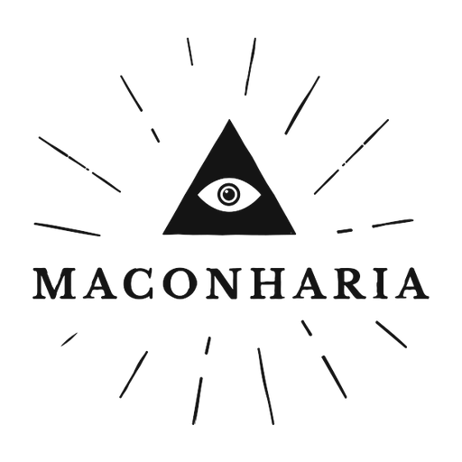

# CRACK — Mod 8 Jogadores

Mod para o jogo **[CRACK](https://store.steampowered.com/app/4312190/CRACK/)** (Rafoli) que aumenta o limite do lobby de **4 para 8 jogadores**. Feito com [BepInEx](https://github.com/BepInEx/BepInEx) + Harmony: nenhum arquivo original do jogo é alterado.

> *English: raises CRACK's co-op lobby cap from 4 to 8 players. Every player in the lobby needs the mod. Download the installer from [Releases](../../releases).*

## Download

Baixe o **`Instalador-CRACK-8Jogadores.exe`** na página de **[Releases](../../releases/latest)** ou direto: [Instalador-CRACK-8Jogadores.exe](https://github.com/IRONSIDEdev/crack-8-players-mod/raw/main/download/Instalador-CRACK-8Jogadores.exe).

(Também há um `.zip` para instalação manual.)

## Como instalar

1. Feche o jogo.
2. Abra o `Instalador-CRACK-8Jogadores.exe`. Ele já vem com a pasta padrão da Steam (`C:\Program Files (x86)\Steam\steamapps\common\CRACK`) e procura nas outras bibliotecas da Steam se o jogo estiver em outro disco. Ou use **Procurar…**.
3. Clique em **Instalar / Atualizar**.
4. Abra o jogo: a versão do mod aparece na tela inicial.

Se o Windows mostrar *"O Windows protegeu o computador"*, clique em **Mais informações → Executar assim mesmo** (o instalador não tem assinatura digital).

**Instalação manual:** extraia o `.zip` dentro da pasta do jogo, ao lado do `CRACK.exe`.

## O que o mod faz

- Lobby de até **8 jogadores** (configurável em `BepInEx\config\crack.8players.cfg` → `MaxPlayers`).
- O mapa tem 4 quartos: os jogadores 5–8 **dividem o quarto** com os jogadores 1–4 (cama, porta com crachá e guarda-roupa). Cada um mantém o próprio casaco.
- Quem divide o quarto nasce ao lado do colega, e a placa do quarto mostra os dois nomes.
- 4 cores extras de jogador.
- Versão do mod e crédito na tela inicial (`CreditText` no mesmo arquivo de configuração).

## Importante

- **Todos do lobby precisam ter o mod.** O próprio jogo recusa misturar jogadores com e sem mod.
- Com mods, o CRACK **desativa conquistas e placares** da Steam. Isso é do jogo, não do mod.
- Depois de uma atualização do jogo, o mod pode precisar ser atualizado.

## Desinstalar

Abra o instalador e clique em **Desinstalar** (ou rode `DESINSTALAR-MOD.bat` na pasta do jogo).
Obs.: *Verificar integridade dos arquivos* da Steam **não** remove o mod.

## Problemas

Abra uma [issue](../../issues) com o arquivo `BepInEx\LogOutput.log` do host e de um jogador 5–8.

## Compilar

- `src/Crack8P`: plugin BepInEx (`dotnet build -c Release -p:GameManaged="<pasta do jogo>\CRACK_Data\Managed"`).
- `src/Installer`: instalador WinForms (.NET Framework 4.8); espera um `payload.zip` com o BepInEx e o plugin.

---

Mod não oficial, sem ligação com a Rafoli. Todos os direitos do jogo pertencem aos desenvolvedores originais; este repositório não contém nenhum arquivo do jogo.
O BepInEx é distribuído sob a licença [LGPL-2.1](https://github.com/BepInEx/BepInEx/blob/master/LICENSE). O código deste mod está sob a licença MIT.

**Mod Desenvolvido por Maçonicos.**
